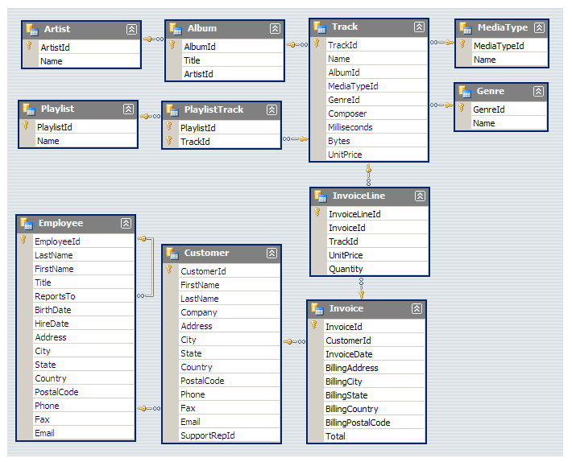

# 🎵 Music Store Data Analysis | SQL Project

## 📌 Project Overview

This project focuses on analyzing an online music store database using **PostgreSQL** to extract meaningful business insights and support data-driven decision-making.

The project explores customer purchasing behaviour, music preferences, sales performance, popular artists, and revenue trends across different countries.

Using SQL queries of varying complexity, the analysis answers 11 business questions categorized into Easy, Moderate, and Advanced levels.

## 🎯 Project Objectives

- Analyze customer purchasing patterns and spending behaviour.
- Identify the most profitable cities and countries.
- Discover popular music genres and top-performing artists.
- Understand customer preferences across different geographical locations.
- Identify high-value customers and revenue opportunities.
- Generate actionable business insights to support marketing and promotional strategies.

## 🗄️ Database Schema

The Music Store database consists of multiple interconnected tables representing customers, employees, music tracks, artists, invoices, and playlists.



### Database Tables

| Table | Description |
|---|---|
| Artist | Stores artist information |
| Album | Contains album details |
| Track | Stores music track information |
| Genre | Contains music genre categories |
| MediaType | Stores media format information |
| Playlist | Contains playlist details |
| PlaylistTrack | Maps tracks to playlists |
| Customer | Stores customer information |
| Employee | Contains employee details |
| Invoice | Stores customer transaction details |
| InvoiceLine | Contains individual purchased tracks |

## 🛠️ Tools & Technologies

- **Database:** PostgreSQL
- **SQL Environment:** pgAdmin 4
- **Query Language:** SQL
- **Database Management:** Relational Database Management System (RDBMS)

## 📊 Business Questions & Analysis

The project addresses 11 business questions across three difficulty levels.

### 🟢 Question Set 1 – Easy

1. Identify the senior-most employee based on job title.
2. Find the countries generating the highest number of invoices.
3. Retrieve the highest invoice values.
4. Identify the city generating the highest total invoice revenue.
5. Find the customer who has spent the most money.

### 🟡 Question Set 2 – Moderate

1. Retrieve email addresses, first names, last names, and music genres of customers who listen to Rock music.
2. Identify the top 10 artists who have contributed the highest number of Rock tracks.
3. Find all tracks whose duration is longer than the average song duration.

### 🔴 Question Set 3 – Advanced

1. Identify the best-selling artist and determine how much each customer has spent on that artist.
2. Find the most popular music genre in each country based on the number of purchases, including ties.
3. Identify the highest-spending customer in each country, including cases where multiple customers share the highest spending amount.

## 💡 SQL Concepts Demonstrated

This project demonstrates practical applications of SQL concepts, including:

- SELECT, WHERE, ORDER BY and LIMIT
- Aggregate Functions – COUNT(), SUM(), AVG(), MAX()
- GROUP BY and HAVING
- INNER JOIN and Multiple Table Joins
- Subqueries and Nested Queries
- Common Table Expressions (CTEs)
- Window Functions – ROW_NUMBER()
- Recursive CTEs
- Data Aggregation and Ranking
- Conditional Filtering and Tie Handling

## 🔍 Analytical Approach

The project follows a structured SQL analysis workflow:

1. **Database Exploration:** Understanding the database structure and relationships between tables.
2. **Data Retrieval:** Extracting relevant information using SQL queries.
3. **Data Integration:** Combining multiple tables using relational joins.
4. **Aggregation:** Calculating revenue, purchase quantities, invoice counts, and customer spending.
5. **Advanced Analysis:** Applying CTEs, subqueries, and window functions to solve complex business problems.
6. **Business Interpretation:** Translating query results into meaningful business insights.

## 📈 Business Applications

The analysis can help a music store:

- Identify high-value customers for targeted marketing campaigns.
- Select cities for promotional music festivals based on revenue.
- Understand regional music preferences.
- Identify popular artists and genres for business partnerships.
- Improve customer engagement through personalized recommendations.
- Develop marketing strategies based on geographical purchasing trends.

## 📁 Repository Structure

```text
Music_Store_Analysis/
│
├── Music_Store_database.sql
├── Music_Store_Query.sql
├── Music Store Analysis-Questions.pdf
├── MusicDatabaseSchema.png
├── album2.csv
├── music store data.zip
├── Raw-Music Store Analysis-SQL Project.zip
│
└── README.md
```

## ⚙️ How to Run the Project

### Prerequisites

- PostgreSQL
- pgAdmin 4
- Music Store database files

### Step 1: Clone the Repository

```bash
git clone https://github.com/KDeepesh22/Music_Store_analysis.git
```

### Step 2: Open pgAdmin 4

Connect to your PostgreSQL server and create or restore the Music Store database.

### Step 3: Import the Database

Use the provided database backup or CSV files to set up the required tables and data.

### Step 4: Execute SQL Queries

Open `Music_Store_Query.sql` in pgAdmin 4's Query Tool.

### Step 5: Run the Analysis

Execute the queries section by section and explore the results for all three difficulty levels.

## 🚀 Key Learning Outcomes

Through this project, I gained practical experience in:

- Writing SQL queries to solve real-world business problems.
- Working with relational databases and complex table relationships.
- Performing customer and revenue analysis.
- Using advanced SQL techniques for analytical problem-solving.
- Converting raw transactional data into actionable business insights.

## 👨‍💻 Author

**Deepesh Kumar**

B.Tech | Indian Institute of Technology (IIT) Patna

- GitHub: [KDeepesh22](https://github.com/KDeepesh22)
- LinkedIn: [Deepesh Kumar](https://www.linkedin.com/in/deepesh-kumar-23b6a433a/)

---

⭐ If you find this project useful, consider giving this repository a star!
